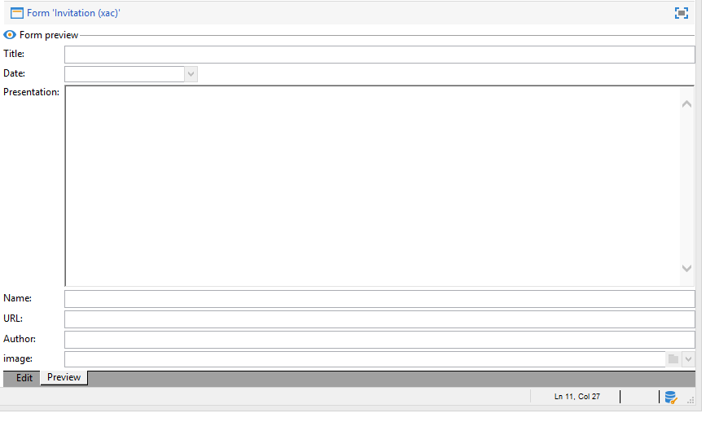

# Editar formularios{#editing-forms}

## Información general

Los especialistas en marketing y los operadores utilizan formularios de entrada para crear, modificar y previsualizar registros. Forms muestra una representación visual de la información.

>[!NOTE]
>
>Como parte del proceso de transición de la versión 7 a 8 de Campaign, toda la documentación de Campaign Classic se ha optimizado y reorganizado. Ahora, las funciones comunes solo están disponibles en el conjunto de documentación de Campaign v8. Para obtener más información sobre los formularios de entrada, consulte la [documentación de Campaign v8](https://experienceleague.adobe.com/es/docs/campaign/campaign-v8/developer/schemas-forms/forms){target=_blank}.
>
>[](https://experienceleague.adobe.com/es/docs/campaign/campaign-v8/developer/schemas-forms/forms){target=_blank}

Puede crear y modificar formularios de entrada:

* Puede modificar los formularios de entrada de fábrica que se envían de forma predeterminada. Los formularios de entrada de fábrica se basan en los esquemas de datos de fábrica.
* Puede crear formularios de entrada personalizados basados en esquemas de datos definidos.

Forms son entidades del tipo `xtk:form`. Puede ver la estructura del formulario de entrada en el esquema `xtk:form`. Para ver este esquema, elija **[!UICONTROL Administration]** > **[!UICONTROL Configuration]** > **[!UICONTROL Data schemas]** en el menú. Más información sobre [estructura de formulario](https://experienceleague.adobe.com/es/docs/campaign/campaign-v8/developer/schemas-forms/forms){target="_blank"} (documentación de Campaign v8).

Para acceder a los formularios de entrada, elija **[!UICONTROL Administration]> [!UICONTROL Configuration] >[!UICONTROL Input forms]** en el menú:


Para diseñar formularios, edite el contenido XML en el editor XML:


[Más información](https://experienceleague.adobe.com/es/docs/campaign/campaign-v8/developer/schemas-forms/forms#formatting){target="_blank"} (documentación de Campaign v8).

Para obtener una vista previa de un formulario, haga clic en la ficha **[!UICONTROL Preview]**:


## Tipos de formularios

Puede crear diferentes tipos de formularios de entrada. El tipo de formulario determina cómo navegan los usuarios por el formulario:

* Pantalla de consola

  Este es el tipo de formulario predeterminado. El formulario consta de una sola página.

  

* Administración de contenido

  Utilice este tipo de formulario para la administración de contenido. Ver este [caso de uso](../../delivery/using/use-case-creating-content-management.md).

  

* Ayudante

  Este formulario consta de varias pantallas flotantes ordenadas en una secuencia específica. Los usuarios navegan de una pantalla a otra. [Más información](https://experienceleague.adobe.com/es/docs/campaign/campaign-v8/developer/schemas-forms/forms#wizards){target="_blank"} (documentación de Campaign v8).

* Iconbox

  Este formulario consta de varias páginas. Para desplazarse por el formulario, los usuarios seleccionan iconos en la parte izquierda del formulario.

  

* Notebook

  Este formulario consta de varias páginas. Para desplazarse por el formulario, los usuarios seleccionan pestañas en la parte superior del formulario.

  

* Panel vertical

  Este formulario muestra un árbol de navegación.

* Panel horizontal

  Este formulario muestra una lista de elementos.

## Referencias a imágenes

Para buscar imágenes, elija **[!UICONTROL Administration]** > **[!UICONTROL Configuration]** > **[!UICONTROL Images]** en el menú.

Para asociar una imagen con un elemento del formulario, por ejemplo, un icono, puede añadir una referencia a una imagen. Utilice el atributo `img`, por ejemplo, en el elemento `<container>`.

Sintaxis: `img="`*`namespace`*`:`*`filename`*`.`*`extension`*`"`

Este ejemplo muestra referencias a las imágenes `book.png` y `detail.png` del espacio de nombres `ncm`:

```xml
<container img="ncm:book.png" label="General">
[…]
</container>
<container img="ncm:detail.png" label="Details">
[…]
</container>
```

Estas imágenes se utilizan para iconos en los que los usuarios hacen clic para desplazarse por un formulario de varias páginas:


## Creación de un formulario simple {#create-simple-form}

Para crear un formulario, siga estos pasos:

1. En el menú, elija **[!UICONTROL Administration]** > **[!UICONTROL Configuration]** > **[!UICONTROL Input forms]**.
1. Haga clic en el botón **[!UICONTROL New]** en la parte superior derecha de la lista.

   

1. Especifique las propiedades del formulario:

   * Especifique el nombre del formulario y el área de nombres.

     El nombre del formulario y el área de nombres pueden coincidir con el esquema de datos relacionado.  Este ejemplo muestra un formulario para el esquema de datos `cus:order`:

     ```xml
     <form entitySchema="xtk:form" img="xtk:form.png" label="Order" name="order" namespace="cus" type="iconbox" xtkschema="xtk:form">
       […]
     </form>
     ```

     También puede especificar explícitamente el esquema de datos en el atributo `entity-schema`.

     ```xml
     <form entity-schema="cus:stockLine" entitySchema="xtk:form" img="xtk:form.png" label="Stock order" name="stockOrder" namespace="cus" xtkschema="xtk:form">
       […]
     </form>
     ```

   * Especifique la etiqueta que se mostrará en el formulario.
   * De forma opcional, especifique el tipo de formulario. Si no especifica un tipo de formulario, se utiliza el tipo de pantalla de la consola de forma predeterminada.

     

     Si está diseñando un formulario de varias páginas, puede omitir el tipo de formulario en el elemento `<form>` y especificar el tipo en un contenedor.

1. Haga clic en **[!UICONTROL Save]**.

1. Inserte los elementos del formulario.

   Por ejemplo, para insertar un campo de entrada, utilice el elemento `<input>`. Establezca el atributo `xpath` en la referencia de campo como una expresión XPath. [Más información](https://experienceleague.adobe.com/es/docs/campaign/campaign-v8/developer/schemas-forms/schema-structure#reference-with-xpath){target="_blank"} (documentación de Campaign v8).

   Este ejemplo muestra campos de entrada basados en el esquema `nms:recipient`.

   ```xml
   <input xpath="@firstName"/>
   <input xpath="@lastName"/>
   ```

1. Si el formulario se basa en un tipo de esquema específico, puede buscar los campos de este esquema:

   1. Haga clic en **[!UICONTROL Insert]** > **[!UICONTROL Document fields]**.

      

   1. Seleccione el campo y haga clic en **[!UICONTROL OK]**.

      

1. De forma opcional, especifique el editor de campos.

   Hay asociado un editor de campos predeterminado con cada tipo de datos:
   * Para un campo de tipo fecha, el formulario muestra un calendario de entrada.
   * Para un campo de tipo lista desglosada, el formulario muestra una lista de selección.

   Puede utilizar estos tipos de editor de campos:

   | Editor de campos | Atributo de formulario |
   | --- | --- |
   | Botón de opción | `type="radiobutton"` |
   | Casilla de verificación | `type="checkbox"` |
   | Editar árbol | `type="tree"` |

   Más información sobre [controles de lista de memoria](https://experienceleague.adobe.com/es/docs/campaign/campaign-v8/developer/schemas-forms/forms#memory-list-controls){target="_blank"} (documentación de Campaign v8).

1. De forma opcional, defina el acceso a los campos:

   | Elemento | Atributo | Descripción |
   | --- | --- | --- |
   | `<input>` | `read-only="true"` | Proporciona acceso de solo lectura a un campo |
   | `<container>` | `type="visibleGroup" visibleIf="`*edit-expr*`"` | Muestra condicionalmente un grupo de campos |
   | `<container>` | `type="enabledGroup" enabledIf="`*edit-expr*`"` | Habilita condicionalmente un grupo de campos |

   Ejemplo:

   ```xml
   <container type="enabledGroup" enabledIf="@gender=1">
     […]
   </container>
   <container type="enabledGroup" enabledIf="@gender=2">
     […]
   </container>
   ```

1. De forma opcional, utilice contenedores para agrupar campos en secciones.

   ```xml
   <container type="frame" label="Name">
      <input xpath="@firstName"/>
      <input xpath="@lastName"/>
   </container>
   <container type="frame" label="Contact details">
      <input xpath="@email"/>
      <input xpath="@phone"/>
   </container>
   ```

   

## Creación de un formulario de varias páginas {#create-multipage-form}

Puede crear formularios de varias páginas. También puede anidar formularios dentro de otros formularios. Obtenga más información sobre [contenedores, bloc de notas y formularios con iconbox](https://experienceleague.adobe.com/es/docs/campaign/campaign-v8/developer/schemas-forms/forms#containers){target="_blank"} (documentación de Campaign v8).

## Modificación de un formulario de entrada de fábrica {#modify-factory-form}

Para modificar un formulario de fábrica, siga estos pasos:

1. Modifique el formulario de entrada de fábrica:

   1. En el menú, elija **[!UICONTROL Administration]** > **[!UICONTROL Configuration]** > **[!UICONTROL Input forms]**.
   1. Seleccione un formulario de entrada y modifíquelo.

   Puede ampliar los esquemas de datos de fábrica, pero no puede ampliar los formularios de entrada de fábrica. Se recomienda modificar los formularios de entrada de fábrica directamente sin volver a crearlos. Durante las actualizaciones de software, las modificaciones realizadas en los formularios de entrada de fábrica se combinan con las actualizaciones. Si la combinación automática falla, puede resolver los conflictos. [Más información](../../production/using/upgrading.md#resolving-conflicts).

   Por ejemplo, si amplía un esquema de fábrica con un campo adicional, puede añadir este campo al formulario de fábrica relacionado.

## Validar formularios {#validate-forms}

Puede incluir controles de validación en los formularios.

### Comprobar campos obligatorios

Puede comprobar la información obligatoria:

* Utilice el atributo `required="true"` para los campos obligatorios.
* Utilice el nodo `<leave>` para comprobar estos campos y mostrar mensajes de error.

En este ejemplo, la dirección de correo electrónico es obligatoria y se muestra un mensaje de error si el usuario no ha proporcionado esta información:

```xml
<input xpath="@email" required="true"/>
<leave>
  <check expr="@email!=''">
    <error>The email address is required.</error>
  </check>
</leave>
```

Obtenga más información sobre [campos de expresión](https://experienceleague.adobe.com/es/docs/campaign/campaign-v8/developer/schemas-forms/forms#expression-field){target="_blank"} (documentación de Campaign v8) y [contexto de formulario](https://experienceleague.adobe.com/es/docs/campaign/campaign-v8/developer/schemas-forms/forms#context-of-forms){target="_blank"} (documentación de Campaign v8).

### Validar valores

Puede utilizar llamadas de JavaScript SOAP para validar datos de formulario desde la consola. Utilice estas llamadas para realizar validaciones complejas, por ejemplo, para comparar un valor con una lista de valores autorizados. [Más información](https://experienceleague.adobe.com/es/docs/campaign/campaign-v8/developer/schemas-forms/forms#soap-methods){target="_blank"} (documentación de Campaign v8).

1. Cree una función de validación en un archivo JS.

   Ejemplo:

   ```js
   function nms_recipient_checkValue(value)
   {
     logInfo("checking value " + value)
     if (…)
     {
       logError("Value " + value + " is not valid")
     }
     return 1
   }
   ```

   En este ejemplo, la función se denomina `checkValue`. Esta función se usa para comprobar el tipo de datos `recipient` en el espacio de nombres `nms`. El valor que se está comprobando se registra. Si el valor no es válido, se registra un mensaje de error. Si el valor es válido, se devuelve el valor 1.

   Puede utilizar el valor devuelto para modificar el formulario.

1. En el formulario, agregue el elemento `<soapCall>` al elemento `<leave>`.

   En este ejemplo, se utiliza una llamada de SOAP para validar la cadena `@valueToCheck`:

   ```xml
   <form name="recipient" (…)>
   (…)
     <leave>
       <soapCall name="checkValue" service="nms:recipient">
         <param exprIn="@valueToCheck" type="string"/>
       </soapCall>
     </leave>
   </form>
   ```

   En este ejemplo, se utilizan el método `checkValue` y el servicio `nms:recipient`:

   * El servicio es el área de nombres y el tipo de datos.
   * El método es el nombre de la función. El nombre distingue entre mayúsculas y minúsculas.

   La llamada se realiza sincrónicamente.

   Se muestran todas las excepciones. Si utiliza el elemento `<leave>`, los usuarios no podrán guardar el formulario hasta que se valide la información introducida.

Este ejemplo muestra cómo puede realizar llamadas de servicio desde formularios:

```xml
<enter>
  <soapCall name="client" service="c4:ybClient">
    <param exprIn="@id" type="string"/>
    <param type="boolean" xpathOut="/tmp/@count"/>
  </soapCall>
</enter>
```

En este ejemplo, la entrada es un ID, que es una clave principal. Cuando los usuarios rellenan el formulario de este ID, se realiza una llamada de SOAP con este ID como parámetro de entrada. El resultado es un booleano escrito en este campo: `/tmp/@count`. Puede utilizar este booleano dentro del formulario. Más información sobre [contexto de formulario](https://experienceleague.adobe.com/es/docs/campaign/campaign-v8/developer/schemas-forms/forms#context-of-forms){target="_blank"} (documentación de Campaign v8).
