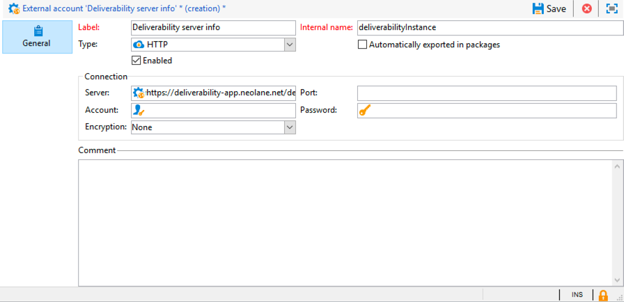

# Representación de la bandeja de entrada{#inbox-rendering}

Adobe Campaign aprovecha la solución de prueba de correo electrónico basada en web [Litmus](https://litmus.com/email-testing) para capturar las renderizaciones de correo electrónico y ponerlas a disposición en un informe específico.

Como parte del proceso de transición de la versión 7 a 8 de Campaign, toda la documentación de Campaign Classic se ha optimizado y reorganizado. Ahora, las funciones comunes solo están disponibles en el conjunto de documentación de Campaign v8. Para obtener más información sobre la renderización de la bandeja de entrada, consulte la [documentación de Campaign v8](https://experienceleague.adobe.com/en/docs/campaign/campaign-v8/send/deliverability-management/inbox-rendering){target=_blank}.

[](https://experienceleague.adobe.com/en/docs/campaign/campaign-v8/send/deliverability-management/inbox-rendering){target=_blank}

## Activación del renderizado de la bandeja de entrada {#activating-inbox-rendering}

[!BADGE On-Premise e híbrido]{type=Caution url="https://experienceleague.adobe.com/docs/campaign-classic/using/installing-campaign-classic/architecture-and-hosting-models/hosting-models-lp/hosting-models.html?lang=es" tooltip="Se aplica solo a implementaciones On-premise e híbridas"}

Para los clientes alojados e híbridos, el servicio de asistencia técnica y consultores de Adobe configuran la renderización de la Bandeja de entrada en la instancia. Para obtener más información, póngase en contacto con su administrador de cuentas de Adobe.

Para las instalaciones in situ, siga los pasos a continuación para configurar la renderización de la Bandeja de entrada.

1. Mediante el menú **[!UICONTROL Tools]** > **[!UICONTROL Advanced]** > **[!UICONTROL Import package]**, instale el paquete **[!UICONTROL Inbox rendering (IR)]**. Para obtener más información, consulte [Instalación de paquetes estándar de Campaign Classic](../../installation/using/installing-campaign-standard-packages.md).
1. Configure una cuenta externa del tipo HTTP mediante el nodo **[!UICONTROL Administration]** > **[!UICONTROL Platform]** > **[!UICONTROL External Accounts]**. Para obtener más información, consulte [Creación de una cuenta externa](../../installation/using/external-accounts.md#creating-an-external-account).
1. Defina los parámetros de cuenta externa de la siguiente manera:
   * **[!UICONTROL Label]**: Información del servidor de envío
   * **[!UICONTROL Internal name]**: deliverabilityInstance
   * **[!UICONTROL Type]**: HTTP
   * **[!UICONTROL Server]**: https://deliverability-app.neolane.net/deliverability
   * **[!UICONTROL Encryption]**: Ninguno
   * Marque la opción **[!UICONTROL Enabled]**.

   

1. Vaya al nodo **[!UICONTROL Administration]** > **[!UICONTROL Platform]** > **[!UICONTROL Options]**. Busque la opción **[!UICONTROL DmRendering_cuid]** y póngase en contacto con el servicio de soporte técnico para obtener el identificador de los informes de envío que debe copiarse en el campo **[!UICONTROL Value (text)]**.
1. Edite el archivo **serverConf.xml** para permitir una llamada al servidor Litmus. Añada la siguiente línea a la sección `<urlPermission>`:

   ```
   <url dnsSuffix="deliverability-app.neolane.net" urlRegEx="https://.*"/>
   ```

1. Vuelva a cargar la configuración con el siguiente comando:

   ```
   nlserver config -reload
   ```

>[!NOTE]
>
>Es posible que tenga que cerrar la sesión desde la consola y volver a iniciarla para poder utilizar la renderización de la Bandeja de entrada.
