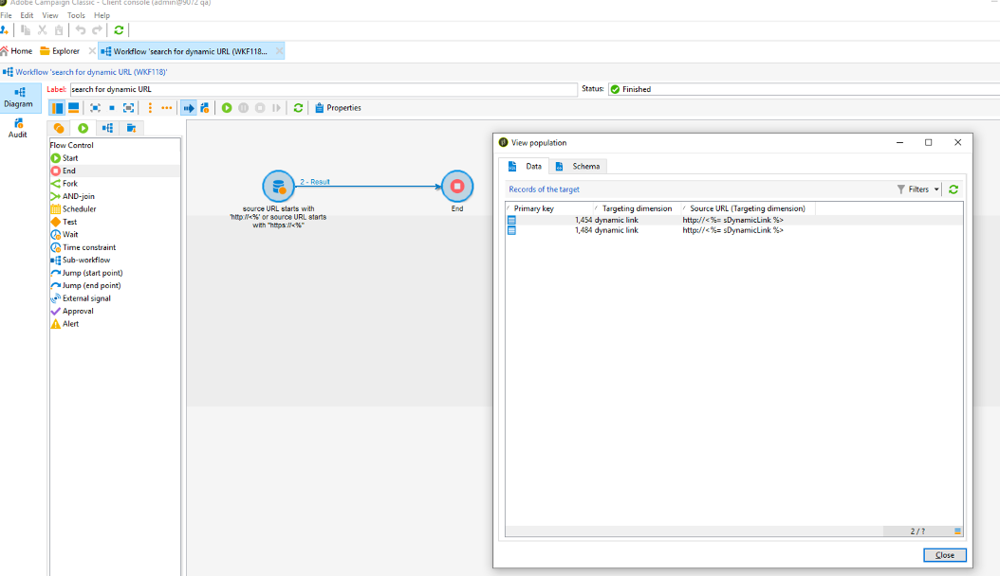

# Personalización y privacidad {#privacy}

Esta página cubre la personalización de URL, la firma de URL y la protección de las páginas que contienen información personal.

>[!NOTE]
>
>Como parte del proceso de transición de la versión 7 a 8 de Campaign, toda la documentación de Campaign Classic se ha optimizado y reorganizado. Ahora, las funciones comunes solo están disponibles en el conjunto de documentación de Campaign v8. Para obtener más información sobre las solicitudes de privacidad y las restricciones de datos, consulte la [documentación de Campaign v8](https://experienceleague.adobe.com/en/docs/campaign/campaign-v8/privacy/security#data-restriction){target=_blank}.
>
>[](https://experienceleague.adobe.com/en/docs/campaign/campaign-v8/privacy/security#data-restriction){target=_blank}

En Campaign Classic v7, la restricción del acceso a toda la entidad requiere la compilación 8770 o posterior.

## Personalización de la URL {#url-personalization}

Al añadir enlaces personalizados al contenido, evite siempre cualquier personalización en la parte del nombre de host de la dirección URL para evitar posibles lagunas de seguridad. Los siguientes ejemplos nunca deben utilizarse en todos los atributos de URL &lt;`a href="">` o ``:

* `<%= url >`
* `https://<%= url >`
* `https://<%= domain >/path`
* `https://<%= sub-domain >.domain.tld/path`
* `https://sub.domain<%= main domain %>/path`

### Recomendación

Para validar y asegurarse de que no está utilizando lo anterior, ejecute una consulta en la tabla de URL de seguimiento a través de [Editor de consultas genérico de Campaign](https://experienceleague.adobe.com/es/docs/campaign/campaign-v8/data/query/query-editor){target="_blank"} (documentación de Campaign v8) o cree un flujo de trabajo con criterios de filtro en la actividad de consulta. Consulte la [documentación de Campaign v8](https://experienceleague.adobe.com/docs/campaign/automation/workflows/wf-activities/targeting-activities/query.html?lang=es){target="_blank"}.

Ejemplo:

1. Cree un flujo de trabajo y agregue una actividad **Query**. Consulte la [documentación de Campaign v8](https://experienceleague.adobe.com/docs/campaign/automation/workflows/wf-activities/targeting-activities/query.html?lang=es){target="_blank"}.

1. Abra la actividad **Query** y cree un filtro en la tabla `nmsTrackingUrl` de la siguiente manera:

   `source URL starts with http://<% or source URL starts with https://<%`

1. Ejecute el flujo de trabajo y compruebe si hay resultados.

1. Si es así, abra la transición de salida para ver la lista de las direcciones URL.

   


### Firma de URL

Para mejorar la seguridad, se ha introducido un mecanismo de firma para el seguimiento de vínculos en correos electrónicos. Está disponible a partir de las versiones 19.1.4 (9032@3a9dc9c) y 20.2. Esta función está habilitada de forma predeterminada.

>[!NOTE]
>
>Cuando se hace clic en una dirección URL firmada con formato incorrecto, se devuelve este error: `Requested URL '…' was not found.`

Además, se puede utilizar una mejora para deshabilitar las direcciones URL generadas en versiones anteriores. Esta función está desactivada de forma predeterminada. Póngase en contacto con el [Servicio de atención al cliente](https://helpx.adobe.com/es/enterprise/admin-guide.html/enterprise/using/support-for-experience-cloud.ug.html) para habilitar esta función.

Si está ejecutando la versión 19.1.4, puede experimentar problemas con los envíos de notificaciones push mediante vínculos de seguimiento o con los envíos que utilizan etiquetas de anclaje. Si es así, le recomendamos que deshabilite la firma de URL.

Como cliente híbrido, de Managed Cloud Services o alojado en Campaign, debe ponerse en contacto con el [Servicio de atención al cliente](https://helpx.adobe.com/es/enterprise/using/support-for-experience-cloud.html) para que se deshabilite la firma de URL.

Si está ejecutando Campaign en una arquitectura híbrida, antes de habilitar la firma URL, asegúrese de que la instancia intermediaria alojada se haya actualizado de la siguiente manera:

* Primero, la instancia de marketing on-premise
* A continuación, actualice a la misma versión que la instancia de marketing local o a una versión ligeramente superior

De lo contrario, pueden producirse algunos de estos problemas:

* Antes de actualizar la instancia de intermediario, las direcciones URL se envían sin firma a través de esta instancia.
* Una vez que se ha actualizado la instancia de intermediario y se ha habilitado la firma de URL en ambas instancias, se rechazan las URL que se habían enviado anteriormente sin firma. El motivo es que los archivos de seguimiento proporcionados por la instancia de marketing solicitan una firma.

Para deshabilitar las direcciones URL que se han generado en versiones anteriores, siga estos pasos en todos los servidores de Campaign al mismo tiempo:

1. En el archivo de configuración del servidor (`serverConf.xml`), cambie la opción **blockRedirectForUnsignedTrackingLink** a **true**.
1. Reinicie el servicio `nlserver`.
1. En el servidor `tracking`, reinicie el servidor `web` (apache2 en Debian, httpd en CentOS/RedHat, IIS en Windows).

Para habilitar la firma de URL, siga estos pasos en todos los servidores de Campaign al mismo tiempo:

1. En el archivo de configuración del servidor (`serverConf.xml`), cambie la opción **signEmailLinks** a **true**.
1. Reinicie el servicio **nlserver**.
1. En el servidor `tracking`, reinicie el servidor `web` (apache2 en Debian, httpd en CentOS/RedHat, IIS en Windows).

## Proteger páginas con API

Recomendamos encarecidamente a los clientes locales que protejan las páginas que puedan contener información personal (PI), como páginas espejo, aplicaciones web, etc.

El objetivo de este procedimiento es evitar que estas páginas se indexen, lo que evita un posible riesgo de seguridad. Estos son algunos artículos útiles:

* [https://developers.google.com/search/reference/robots_txt](https://developers.google.com/search/reference/robots_txt)
* [https://developers.google.com/search/reference/robots_meta_tag](https://developers.google.com/search/reference/robots_meta_tag)

Para proteger las páginas, siga estos pasos:

1. Agregue un archivo `robots.txt` en la raíz del servidor web (Apache o IIS). Este es el contenido del archivo:

   ```sql
   # Make changes for all web spiders
   User-agent:
   *Disallow: /
   ```

   Para IIS, consulte [esta página](https://docs.microsoft.com/en-us/iis/extensions/iis-search-engine-optimization-toolkit/managing-robotstxt-and-sitemap-files).

   Para Apache, puede colocar el archivo en **/var/www/robots.txt** (Debian).

1. A veces, agregar un archivo **robots.txt** no es suficiente en términos de seguridad. Por ejemplo, si otro sitio web contiene un vínculo a su página, podría aparecer en un resultado de búsqueda.

   Además del archivo **robots.txt**, se recomienda agregar un encabezado **X-Robots-Tag**. Puede hacerlo en Apache o IIS y en el archivo de configuración **serverConf.xml**.

   Para obtener más información, consulte [este artículo](https://developers.google.com/search/reference/robots_meta_tag).
